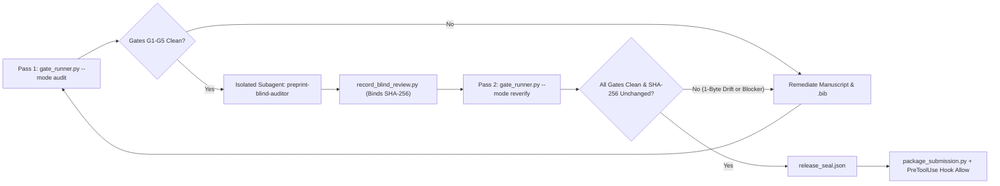

# RxivGate (`rxiv-gate`)

**Two-pass scientific preprint compliance, live citation verification, and SHA-256 cryptographic hard gates for [Google Antigravity](https://antigravity.google).**

Built for researchers in the **Google Antigravity for Science** cohort (and the broader scientific community) to audit, re-verify, and cryptographically seal manuscripts before submitting to **arXiv**, **bioRxiv**, **medRxiv**, or **ChemRxiv**.

---

## Why `rxiv-gate` Exists

Agentic research workflows accelerate mathematical derivation, simulation, and manuscript preparation—but introduce failure modes that standard TeX linters and HTTP-200 link checkers miss:
- **Real-DOI / Wrong-Paper Citation Conflations**: A `.bib` entry whose DOI resolves (`HTTP 200`) to a completely unrelated article.
- **Unattributed Science Plugin Databases**: Missing bibliography citations required by third-party databases queried through the Google DeepMind Science Plugin (`SKILL_LICENSES.md`).
- **Undisclosed AI Workflows or Prohibited AI Authorship**: Missing *Methods* disclosures, missing human-verification attestations, or accidental AI co-authorship.
- **Overstated *In Silico* Claims & Clinical Screening Blockers**: Purely computational predictions phrased as wet-lab/clinical validation, or missing IRB / `NCT` clinical trial IDs on `medRxiv`.
- **Post-Review Edit Drift**: Last-minute `.tex` or `.bib` edits made *after* an audit or review has already passed.

`rxiv-gate` enforces **6 deterministic Hard Gates**, an isolated fresh-context **Blind Auditor Subagent** (`preprint-blind-auditor`), a **Two-Pass Merkle SHA-256 Release Seal**, and an Antigravity **`PreToolUse` Runtime Hook** that physically blocks submission packaging if any gate fails or if even **1 byte** changes after re-verification.

---

## The 6 Hard Gates

| Gate ID | What It Enforces | Failure Action |
| :--- | :--- | :--- |
| **`G1_AI_ATTRIBUTION`** | Blocks AI models/agents in the Author list (ICMJE/COPE); verifies *Methods* AI disclosure (`Antigravity` + `Gemini` model + explicit human verification/responsibility attestation); verifies Google Science program acknowledgment; blocks unauthorized Google/DeepMind logos. | **HARD BLOCK** (`exit 2`) |
| **`G2_SKILL_LICENSES`** | Scans manuscript prose, code scripts, and `.licenses/` against 34 scientific databases/tools across all 41 Google DeepMind Science Plugin skills (AlphaFold DB, AlphaGenome, Boltz, ChEMBL, PubChem, gnomAD, GTEx, UniProt, Reactome, RCSB PDB, RDKit, OpenMM, AutoDock Vina, etc.) and ensures each detected source is formally cited. | **HARD BLOCK** (`exit 2`) |
| **`G3_CITATIONS`** | Parses `.bib` (arbitrary nested brace depth), `\cite{}`, and Markdown `[@key]` citations; queries **Crossref**, **PubMed E-utilities**, and **arXiv** APIs; enforces canonical **Title Similarity (`>= 0.45`)** to catch real-DOI / wrong-paper hallucinations; blocks `TODO`/`TBD`/`[?]` placeholders. | **HARD BLOCK** (`exit 2`) |
| **`G4_SERVER_SCREENING`** | Enforces server-specific rules for `arxiv` (including the `1,920`-char Step-3 abstract limit and `..` path checks), `biorxiv`, `medrxiv`, and `chemrxiv`: abstract bounds, affiliations, concrete Code/Data Reproducibility links, Competing Interests, IRB/ethics statements, and `medRxiv` clinical trial registration IDs (`NCT...`) + clinical directive safety checks. | **HARD BLOCK** (`exit 2`) |
| **`G5_CLAIM_GROUNDING`** | Detects purely computational / host-emulated studies and blocks unhedged wet-lab or clinical efficacy claims in Title, Abstract, and Conclusions. | **HARD BLOCK** (`exit 2`) |
| **`G6_REVERIFICATION_SEAL`** | Enforces **Pass-1 Audit -> Remediation -> Stateless `preprint-blind-auditor` Review -> Pass-2 Re-Verification** locked to an exact Merkle **SHA-256** manifest digest (`.preprint_gate/.../release_seal.json`). | **HARD BLOCK** (`exit 2` + `PreToolUse` `"deny"`) |

---

## Two-Pass Hard-Gate Workflow



---

## Installation

```bash
git clone https://github.com/deesatzed/rxiv-gate.git
cd rxiv-gate
./install.sh
```

*(For local plugin development, run `./install.sh --link` to symlink into `~/.gemini/config/plugins/rxiv-gate`.)*

Restart **Google Antigravity** once after installing to activate the `rxiv-gate` plugin, `preprint-readiness-gate` skill, `preprint-blind-auditor` subagent, `rules/AGENTS.md`, and `hooks.json` runtime hard gate.

---

## CLI Usage (Single-File or Directory Mode)

`rxiv-gate` supports both **single-file targeting** (`--manuscript-file`, ideal when multiple `.tex` papers share a single `references.bib`) and **whole-directory targeting** (`--manuscript-dir`):

```bash
# 1. Pass-1 Audit (with live Crossref / PubMed / arXiv DOI & title verification)
python3 skills/preprint-readiness-gate/scripts/gate_runner.py \
  --manuscript-file /path/to/paper1.tex \
  --server arxiv \
  --mode audit \
  --citation-mode online

# 2. Bind Isolated Blind Auditor Report to Live Merkle SHA-256
python3 skills/preprint-readiness-gate/scripts/record_blind_review.py \
  --manuscript-file /path/to/paper1.tex \
  --server arxiv \
  --review-file /tmp/blind_review.json

# 3. Pass-2 Hard-Gate Re-Verification (writes .preprint_gate/<stem>/release_seal.json)
python3 skills/preprint-readiness-gate/scripts/gate_runner.py \
  --manuscript-file /path/to/paper1.tex \
  --server arxiv \
  --mode reverify \
  --citation-mode online

# 4. Package Sealed Submission Archive + Compliance Certificate
python3 skills/preprint-readiness-gate/scripts/package_submission.py \
  --manuscript-file /path/to/paper1.tex \
  --server arxiv \
  --output /path/to/paper1_arxiv_sealed.tar.gz
```

---

## Running the Automated Test Suite

Zero third-party Python packages are required (pure Python 3.10+ standard library):

```bash
python3 -m unittest discover -s tests -v
```

---

## License & Disclaimer

Licensed under the **Apache License, Version 2.0** (see [LICENSE](LICENSE)).

`rxiv-gate` is an independent open-source community plugin built for Google Antigravity users and is not affiliated with or endorsed by Google LLC, Cornell University (arXiv), or Cold Spring Harbor Laboratory (bioRxiv/medRxiv). Authors remain solely responsible for the accuracy, ethical compliance, and data licensing of their manuscripts.
